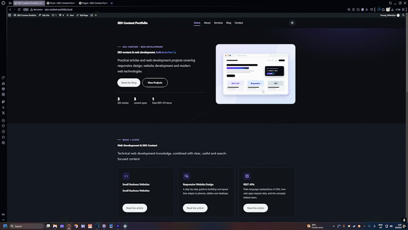

# SEO Content & Web Development Portfolio

A WordPress portfolio that shows SEO content work from start to finish: search intent research, keyword research, outlines, SEO briefs and metadata, articles, WordPress publishing, a custom child theme, and a small Flask REST API that supports one of the articles.



---

## Table of Contents

- [What This Portfolio Shows](#what-this-portfolio-shows)
- [Content Samples](#content-samples)
- [SEO Workflow](#seo-workflow)
- [WordPress Implementation](#wordpress-implementation)
- [Child Theme](#child-theme)
- [REST API Demo](#rest-api-demo)
- [Technologies](#technologies)
- [Project Structure](#project-structure)
- [WordPress Site Structure](#wordpress-site-structure)
- [Known Limitations](#known-limitations)
- [License](#license)

---

## What This Portfolio Shows

The three content samples each target a different search intent, and they are all published on one WordPress site, so the work can be compared side by side. The repository holds the research, briefs, and drafts behind each article, along with the theme and the demo code that the articles refer to.

| Area | Where to look |
| --- | --- |
| Search intent and keyword research | `research/` |
| Outlines, SEO briefs, and metadata | `research/`, `seo/` |
| Published articles (Markdown drafts) | `content/` |
| WordPress publishing notes and checklists | `wordpress/` |
| Custom WordPress child theme | `theme/seo-portfolio-child/` |
| Flask REST API demo | `api-demo/` |
| Process documentation | `docs/workflow.md` |

---

## Content Samples

### Sample 1: Informational

**How to Build a Responsive Website**

- Informational search intent
- Keyword research and an outline built around it
- Educational content with SEO-friendly headings
- Responsive web development concepts

### Sample 2: Commercial and Investigational

**Best Website Features for Small Businesses**

- Commercial search intent
- Comparison-style content
- Structured recommendations
- Business-focused web content

### Sample 3: Technical

**What Is a REST API and How Does It Work?**

- Technical writing for an informational query
- REST concepts: HTTP methods, endpoints, JSON, and status codes
- A working Flask API that the article's examples are based on
- Technical publishing on WordPress

---

## SEO Workflow

Each sample goes through the same steps. The full process is in [`docs/workflow.md`](docs/workflow.md).

1. Search intent research
2. Keyword research
3. Content outline
4. SEO brief
5. SEO metadata
6. Article drafting
7. WordPress implementation
8. Internal linking
9. Responsive testing
10. Content review

---

## WordPress Implementation

All three articles are WordPress posts on the same site. They use:

- Gutenberg blocks
- Categories and tags
- Featured images
- Internal links between the articles
- SEO metadata for titles and descriptions
- Code blocks and tables
- Responsive content formatting

The publishing notes for each sample are in `wordpress/`, and the design changes made in the second version of the site are recorded in [`wordpress/redesign-log.md`](wordpress/redesign-log.md).

---

## Child Theme

`theme/seo-portfolio-child/` is a child theme of Twenty Twenty-Five. It is the source of the site's design:

- **Design tokens** in `theme.json`, with a violet accent and neutral palette
- **Light and dark modes** with a saved toggle
- **Block patterns** for the hero, service cards, featured article, case studies, and contact details
- **Templates** for the front page, blog, archives, single articles, and the About, Services, and Contact pages
- **Light motion**: a reveal-on-scroll effect and a header that responds to scrolling
- **Helpers** in `inc/`, for example to set up the navigation, related posts, and excerpts

**Requirements:** WordPress 6.6 or later, PHP 7.4 or later, and the Twenty Twenty-Five parent theme.

To install it, copy the folder into `wp-content/themes/`, then activate **SEO Portfolio Child**. The redesign log has the full checklist, including the reading settings (a static home page and a separate blog page).

---

## REST API Demo

Sample 3 includes a small Flask API for an in-memory product list. It has the five standard operations:

```text
GET    /api/products
GET    /api/products/<id>
POST   /api/products
PUT    /api/products/<id>
DELETE /api/products/<id>
```

It returns `200`, `201`, `400`, and `404`, and it checks that `name` and `price` are present when a product is created. It is an educational demonstration and is not intended for production use.

To run it:

```bash
cd api-demo
python -m venv venv
source venv/bin/activate        # Windows: venv\Scripts\activate
pip install -r requirements.txt
python app.py
```

The server starts at `http://127.0.0.1:5000`. Example request:

```bash
curl -X POST http://127.0.0.1:5000/api/products \
  -H "Content-Type: application/json" \
  -d '{"name": "Monitor", "price": 12000}'
```

Details for each endpoint are in [`api-demo/README.md`](api-demo/README.md). Screenshots of the requests are in `images/sample-3/screenshots/`.

---

## Technologies

- WordPress and LocalWP for local development
- PHP, HTML, CSS, and JavaScript for the child theme
- Python and Flask for the API demo
- HTTP, JSON, and REST concepts
- Markdown for research, briefs, and drafts
- Git and GitHub
- Thunder Client for testing API requests

---

## Project Structure

```text
p12-seo-content-portfolio/
├── api-demo/                # Flask REST API for Sample 3
│   ├── app.py
│   ├── requirements.txt
│   └── README.md
├── content/                 # the three articles (Markdown)
├── docs/
│   └── workflow.md          # the SEO workflow
├── images/
│   ├── site/                # site imagery
│   ├── sample-1/            # Sample 1 images
│   ├── sample-2/            # Sample 2 screenshots of the Luna Café project
│   └── sample-3/            # featured image, flow diagram, and API request screenshots
├── research/                # search intent, keyword research, and outlines for each sample
├── seo/                     # SEO briefs and metadata for each sample
├── theme/
│   └── seo-portfolio-child/ # WordPress child theme
├── wordpress/               # publishing notes for each sample, and the redesign log
├── .gitignore
├── .gitattributes
└── README.md
```

---

## WordPress Site Structure

```text
WordPress Website
│
├── Home
├── About
├── Services
├── Blog
│   ├── How to Build a Responsive Website
│   ├── Best Website Features for Small Businesses
│   └── What Is a REST API and How Does It Work?
└── Contact
```

---

## Known Limitations

- **Demo API only.** The Flask API stores products in memory, so all changes are lost when the server restarts.
- **Duplicate IDs after a delete.** New products get the ID `number of products + 1`. If a product is deleted, the next product can receive an ID that is already in use. For example, after deleting product 1 from a list of two, a new product gets ID 2, which duplicates the existing one. This is a known bug in the demo, and the fix is to use a counter that only increases.
- **Limited validation.** The API checks that `name` and `price` are present, but it doesn't check their types or values.
- **Debug mode.** `app.py` runs with `debug=True`, which is for local use only.
- **Virtual environment in the archive.** `api-demo/venv/` is excluded by `.gitignore`, so it should not be committed. If a copy of the project includes it, delete it before sharing.
- **Local WordPress setup.** The site was built in LocalWP. Recreating it requires the parent theme and the manual checklist in the redesign log.

---

## License

The license for this repository is still to be decided.

---

## Author

Created by [bmarkjan-stack](https://github.com/bmarkjan-stack) as a portfolio project. Website: <https://bmarkjan-stack.github.io>